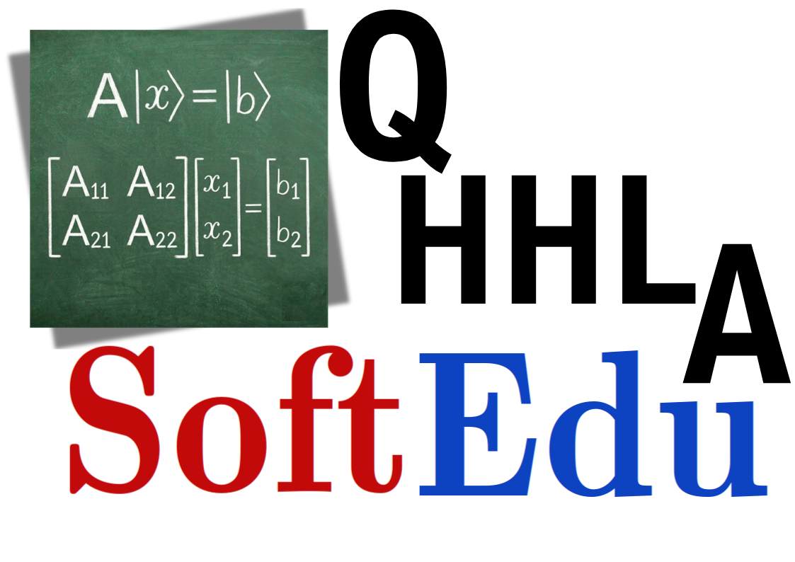

# Quantum HHL Algorithm - Software Education

**QHHLA-SoftEdu** is an educational computational tool designed to support the teaching and deep understanding of the Harrow-Hassidim-Lloyd (HHL) quantum algorithm. Acting as an interactive "virtual laboratory," it allows users to solve linear systems of equations ($Ax=b$) while visualizing the sequential evolution of quantum registers step-by-step. By breaking down the "black box" of quantum computing, this software facilitates the didactic transposition of complex concepts for students and researchers.

<p align="center">
  <!-- Replace with your actual logo path once uploaded to GitHub -->
  
</p>

## 🌟 Key Features

The software breaks down the algorithm into 8 sequential steps, analyzed simultaneously across four distinct dimensions (Tabs):

*   **MATH (Analytical Evolution):** Displays real-time Dirac notation and algebraic equations describing the system's wavefunction at each stage, highlighting changes individually and globally.
*   **MATRIX (Matrix Representation):** Exposes the step-by-step matrix transformations (such as Hadamard gates, controlled rotations, and IQFT) and their equivalent classical column vectors.
*   **CIRCUIT (Quantum Architecture):** Dynamically draws and updates the quantum circuit architecture as the algorithm progresses through the registers (Clock, Index, and Ancilla).
*   **GRAPH (Visual/Geometric Representation):** Provides an interactive visual environment, including 2D classical planes, probability histograms, animated phasors, and 3D Bloch spheres to represent the quantum state.

## 🛠️ Requirements

To compile and run QHHLA-SoftEdu properly, you need a GNU/Linux environment with the following dependencies installed:

*   `ROOT CERN` (specifically `root.exe`, `rootcling`, and `root-config`)
*   `g++` (C++ Compiler)
*   `wget`
*   `zenity` (for the graphical installation prompts)

## 🚀 Installation

For ease of deployment, the project includes automated Bash scripts that handle the downloading, compilation, and configuration of the environment. 

1. Clone this repository or download the installation script.
2. Run the installation script in your terminal:
   ```bash
   ./install_QHHLA.sh
   ```
3. The script will verify dependencies, compile the source code using `rootcling` and `g++`, link the necessary ROOT libraries (`-lGeom`, `-lGeomPainter`), and create a desktop shortcut for easy access.

To uninstall, simply run the provided `uninstall_QHHLA.sh` script, which will safely remove the binaries and clean up your environment paths.

## 🎓 Educational Context
This project was developed as part of a research initiative to promote Scientific and Technological Literacy in quantum computing. It aims to lower the learning curve for physics and engineering students by providing a robust, free, and accessible tool built on the ROOT C++ data analysis infrastructure.
